# Feature compatibility tracking

What this is: a set of probes that check, per feature, whether a Gradle project copes with Gradle, AGP and Kotlin features. It runs on nowinandroid today. Results are JSON files, and a static dashboard reads them.

What it is not: a readiness score. No source says what AGP 10, Gradle 10 or Kotlin 2.5 contain, so nothing here claims readiness. Each probe reports one feature, with one of five states.

## The flow

```mermaid
flowchart LR
  A[Pick commits or tool versions] --> B[make_config.py writes a vmatrix config]
  B --> C[One CI job per cell: vmatrix.py run]
  C --> D[Cell files: logs, configuration cache report, cell.json]
  D --> E[Probes read the files: probes/cell.py]
  E --> F[aggregate step writes one JSON per series]
  F --> G[data/*.json committed, frozen]
  G --> H[build_data.py bundles data.js]
  H --> I[docs/dashboard/index.html]
```

Two probes do not need a build: flag availability reads plugin jars from Maven, and the known-issue probe clones a repro repo and checks the log for the issue's signature.

## Result states

| State | Meaning |
|---|---|
| pass | The feature check passed |
| fail | It failed. A flag build that fails is "failed with this value", not "incompatible" |
| inconclusive | We could not tell (missing or unreadable report, infrastructure error). Always has a reason. Never counted as zero or as a regression |
| not_applicable | The feature does not exist in that version |
| not_run | Listed, but no test is defined |

Rule: a report a parser cannot read is inconclusive, never "0 problems". Each parser has tests against real captured files in `tools/version-matrix/tests/fixtures/`.

## Probes

| Probe | Code | Config | Workflow | Data |
|---|---|---|---|---|
| Configuration cache problems | `probes/configuration_cache.py` | `configuration_cache.json` | `history-series` | `data/history/` |
| Gradle deprecations | `probes/deprecations.py` | `deprecations.json` | `history-series` | `data/history/` |
| Flag availability (no build) | `probes/flag_availability.py` | `flags.json` | `flag-availability` | `data/flag-availability/` |
| Flag builds (one build per flag) | `labs/flag-builds/` | `flags.json` | `flag-builds` | `data/flag-builds/` |
| Known issue (KT-90672) | `probes/known_issue.py` | `known_issues.json` | `known-issue` | `data/known-issues/` |

All probe code is under `tools/version-matrix/probes/`. Workflows are in `.github/workflows/`.

## Run it

- One commit per cell: `python3 labs/history-series/make_config.py OUT.json SHA ...`, then `python3 tools/version-matrix/vmatrix.py run OUT.json`. Each cell builds the commit it names, with the Gradle, AGP and Kotlin versions that commit pins (the "per-cell ref").
- In CI: dispatch `history-series` with space-separated full SHAs. It builds one job per SHA and aggregates to `history.json`.
- Re-run a parser on saved logs without rebuilding: `labs/history-series/aggregate_history.py`.
- Refresh the dashboard after new data: copy the JSON into `data/`, then `python3 docs/dashboard/build_data.py`.

## Add a probe

1. Write `probes/<name>.py` with `parse(...)` returning `probes.result(state, reason, **fields)`. Put values that may change (globs, args, flag lists) in `probes/<name>.json`, not in code.
2. Save one real report or log from a CI run under `tests/fixtures/` and write a test that parses it. Add a test for the unreadable case: it must return inconclusive.
3. If the probe reads files from a finished cell, call it from `probes/cell.py`. If it needs its own build or no build, add a `workflow_dispatch` workflow and a compare step in the same change (repo rule for every lab).
4. Commit the data under `data/<name>/` and add a section to `docs/dashboard/index.html`. Every chart needs a table view and a hover tooltip.
5. Freeze the parser per series. If you change a parser, re-run the aggregate on the saved logs so the whole series uses one parser version.

## Adapt it to another project (for example a company app)

Keep company data out of this public repo. Use a private copy of the repo, or a private workflow.

- Project and commits: change `project` in the vmatrix config and pass that project's SHAs. Cell names, guard tasks and the task list (`:app:assembleDemoDebug` today) are in `make_config.py`; change them to the project's own.
- Tool versions are read from the project's `gradle/wrapper/gradle-wrapper.properties` and `*.versions.toml` at each commit. If the project pins versions elsewhere, extend `vmlib/project.py` (`ref_view`).
- Probes that read cell files work unchanged. Flag availability and known-issue probes do not depend on the project.
- Flag builds apply each flag with `-P<flag>=<value>`. A project that already sets a flag in `gradle.properties` needs that flag removed first, or the result is meaningless.
- A company build usually has private repositories and credentials. Provide them through the CI secret store, never in a file here. Show company results as screenshots in a talk, not as data in the public repo.

## Known limits

- The history set is 10 commits, each built once, cold. Timings are single runs on x86 Linux runners; compare outcomes, not seconds.
- Flag availability comes from class-file strings. "Known" means the name exists, not its default. This is inferred, not public API.
- Flag test values are chosen from the flag name. A pass does not prove the flag changed anything.
- Flag builds ran on one AGP and Kotlin pairing (9.3.2 and 2.3.0). More pairings are possible through the `agp_version` and `kotlin_version` inputs.
- The configuration cache chart is zero on every commit. The parser's branches for old Gradle layouts with problems are untested because no real report with problems was captured.
- `android.simulateAgpVersionBehavior` is experimental and undocumented.
- Not built: R8 probe, plugin status, agent-written chart annotations, Isolated Projects probe.
